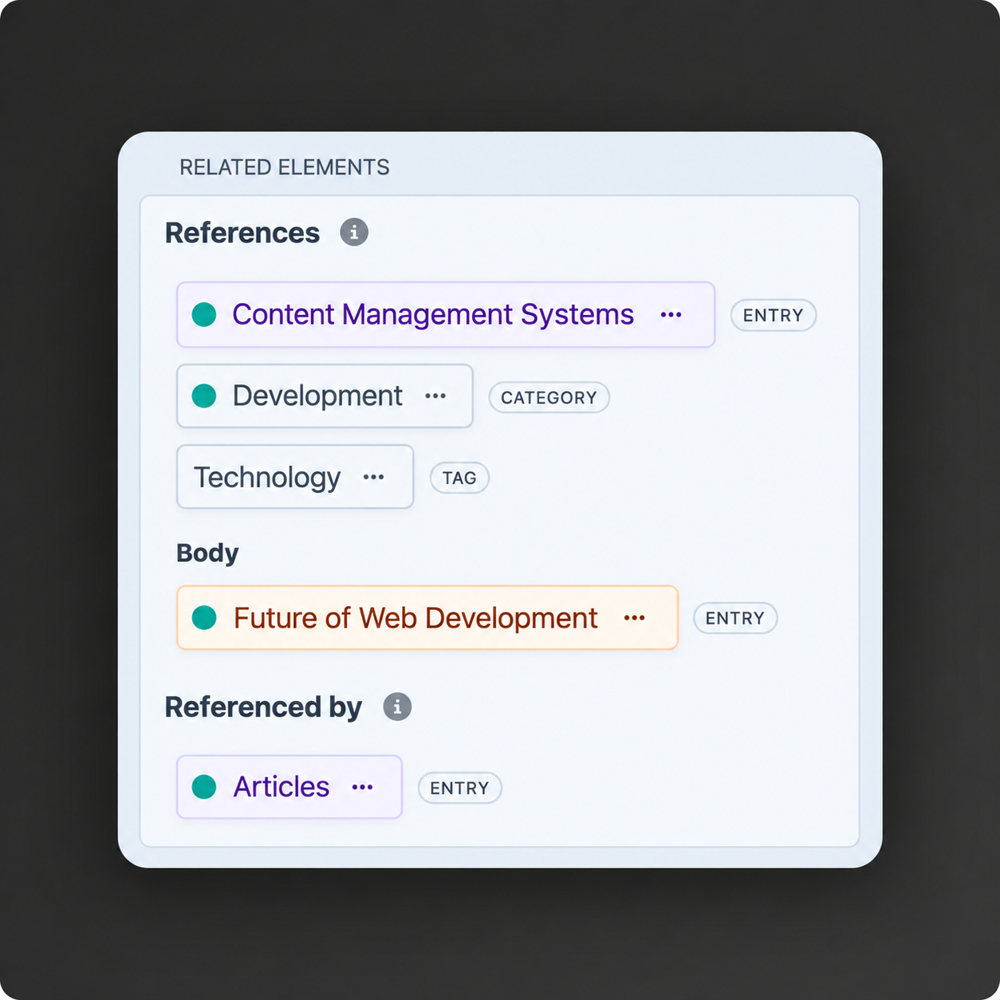

# Related Elements

Displays related elements of an entry, category or asset in the control panel edit view sidebar.



## Requirements

This plugin requires Craft CMS 5.0.0 or later, and PHP 8.2 or later.

## Installation

You can install this plugin from the Plugin Store or with Composer.

### From the Plugin Store

Go to the Plugin Store in your project's Control Panel and search for "Related Elements". Then press "Install".

### With Composer

Open your terminal and run the following commands:

```bash
# go to the project directory
cd /path/to/my-project.test

# tell Composer to load the plugin
composer require mindseeker-media/craft-related-elements

# tell Craft to install the plugin
./craft plugin/install related-elements
```

## Configuration

Configure options in the control panel under Settings → Related Elements or create a configuration file config/related-elements.php.

```php
<?php

return [
    'enableNestedElements' => true,
    'initialLimit' => 10,
    'showElementTypeLabel' => true,
    'defaultElementTypes' => ['entries', 'categories', 'assets', 'tags'],
    'enabledEntryTypeUids' => [],
    'enabledSectionUids' => [],
];
```

### Settings

- **enableNestedElements** (boolean, default: `true`) - Whether to display the related elements that exist inside Content Block, CKEditor, Matrix or Neo fields of an element. Content Block support requires Craft 5.8 or later.
- **initialLimit** (integer, default: `10`) - Number of related elements to show initially before requiring "Show More" to expand the list.
- **showElementTypeLabel** (boolean, default: `true`) - Whether to display the element type labels (Entry, Category, Asset, Tag) next to each related element.
- **defaultElementTypes** (array, default: all types) - Element types shown in the sidebar. Supported values are `entries`, `categories`, `assets`, and `tags`.
- **enabledEntryTypeUids** (array, default: `[]`) - Entry type UIDs where the sidebar is enabled. An empty array or `['*']` enables all entry types.
- **enabledSectionUids** (array, default: `[]`) - Section UIDs where the sidebar is enabled. An empty array or `['*']` enables all sections.

The initial limit is applied separately to the **References** and **Referenced by** sections. Each section loads additional results on demand, so large relationship sets are not loaded into memory when the editor opens.

With nested elements enabled, **References** includes CKEditor and Matrix entries themselves, plus supported related elements inside Content Block, CKEditor, Matrix, and Neo fields at any nesting depth. Content Blocks and Neo blocks act as containers; their related elements are listed under the field name. **Referenced by** resolves nested sources to their top-level owners, including shared owners. Relationships use Craft's relation and ownership tables, without scanning every entry. Incoming results exclude drafts, revisions, and deleted containers.
